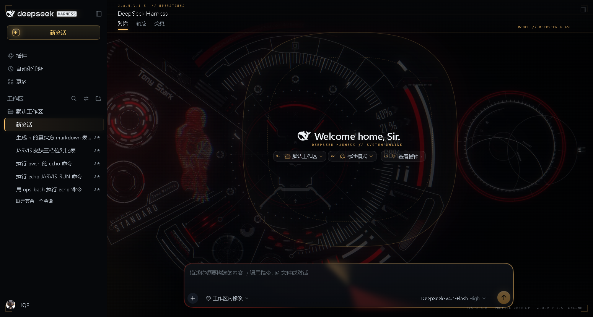
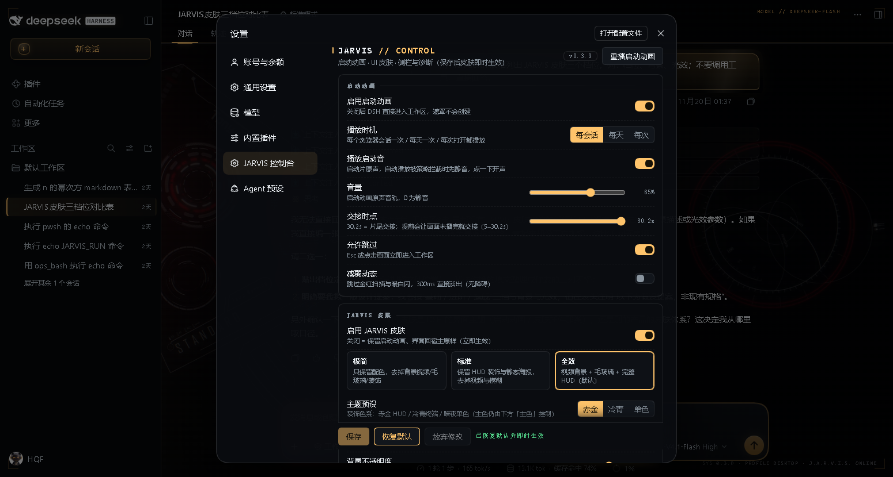
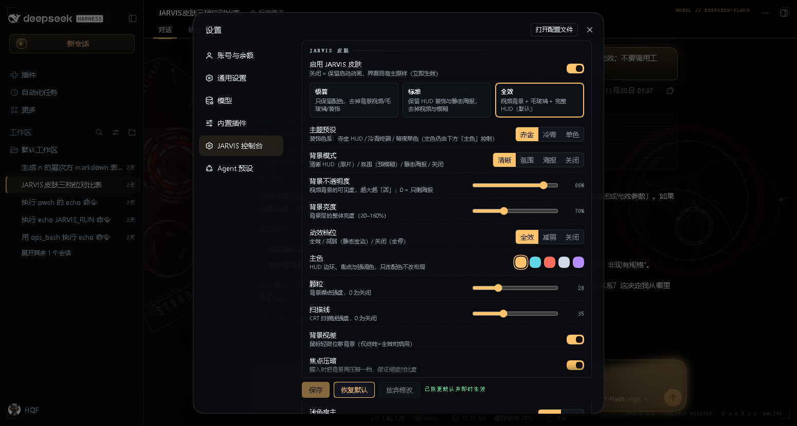

# JARVIS · 钢铁侠 — DeepSeek Harness 启动动画 + UI 皮肤

> **v0.3.9 · 完整素材开源版**：30.2 秒冷启动电影 → 金红闪扫交接 → 一整屏「JARVIS 战情室」操作界面。
> 启动片、动态背景、皮肤代码、设置页、全部内嵌素材与验收文档都在这个仓库里，克隆即可运行，不联网、不下载素材、无功能阉割。

[](https://github.com/QIFANAI/dsh-startup-jarvis/actions/workflows/test.yml)
[](LICENSE)
[](https://github.com/QIFANAI/dsh-startup-jarvis)



**一句话**：把 DeepSeek Harness 的冷启动和主界面一起换成钢铁侠的 JARVIS——开机先看一段 30.2 秒的启动片，
片尾用「金红扫描 + 暖白闪 + 分区显影」交接进操作界面；界面底色是一段持续播放的 HUD 核心影像，
侧栏、输入卡、消息气泡、工具卡、设置页全部落在赤金玻璃仪表盘上。

- 插件 ID：`dsh-startup-jarvis`　版本：`0.3.9`　宿主实测：DSH `0.2.2-rc.5`（Windows 桌面版）
- 运行时零依赖：Host 半侧只有 `node:` 内置模块；客户端是纯 CSS + 原生 JS
- 设计文档：[`docs/design-v0.6.md`](docs/design-v0.6.md)（UI 皮肤总规划）· [`docs/design-v0.3.md`](docs/design-v0.3.md)（启动动画接入）
- 验收归档：[`docs/verify/`](docs/verify/) · Release 说明：[`docs/PUBLIC-RELEASE.md`](docs/PUBLIC-RELEASE.md)

---

## 1. 它做了什么

### 1.1 冷启动电影（30.2 秒）

| 时间 | 画面 |
|---|---|
| 0.0–2.45 | 底部 `DEEPSEEK HARNESS` 品牌淡入 + `BOOT SEQUENCE / JARVIS` |
| 2.45–11.05 | 四条台词字幕（英/中，烧字进片）：Welcome home, sir. / You need to pay attention… / With every passing hour… / enjoy your time, sir. |
| 11.2–13.4 | 底部加载条 `DSH CORE · LOADING` |
| 13.2–19.0 | 右侧 `GLOBAL WORKSPACE` 面板（SKILLS / BUNDLES / MODEL / SESSION） |
| 19.2–24.9 | 左侧 `SYSTEM CHECK` 六项真数据 |
| 25.86 | **Logo slam**：DEEPSEEK HARNESS 砸入 + `SYSTEM READY · ACCESS LEVEL 3` |
| 30.20 | **交接**：冻结最后一帧 → 金红扫描线 + 暖白闪（峰值 300ms）→ 启动层下分区显影 → 在已显影 UI 上淡出，总约 1.2s |

- 成片规格：1920×1080 / 30fps / H.264 + AAC，音轨为原片原声（作者自剪成片，未改内容）
- 播放时机：`session`（每个会话一次，默认）/ `daily`（每天一次）/ `always`（每次打开）
- 兜底：自动播放被拦 → 静音播放；8s 看门狗；解码失败 → 海报静帧 300ms 后退出；`reducedMotion` → 300ms 直接淡出
- 随时可跳过：`Esc`、点击画面或点击「跳过」

### 1.2 操作界面皮肤

| 区域 | 内容 |
|---|---|
| 背景 | `hud` 清晰 HUD / `ambient` 预模糊氛围 / `poster` 静态海报 / `off`；不透明度、亮度、视差可调 |
| Hero | `Welcome home, Sir.` + 同心反应堆环 + `01/02/03` 工作区·模式·查看插件 chips + 底部金环输入卡 |
| 侧栏 | 345px 玻璃侧栏、深链高亮、MK VII 徽章（≥330px）、收起/展开跟随宿主 |
| 顶栏 | `J.A.R.V.I.S. // OPERATIONS` 铭牌 + `MODEL // DEEPSEEK-FLASH`，避开右侧按钮 |
| 消息 | 用户金气泡 + 1px conic 金/红呼吸边环 + 外侧柔光 + 7s 斜向高光；视口外自动暂停动画 |
| 工具/代码 | `pwsh` 工具大卡（命令/输出/DONE）、过程组玻璃壳、代码块金线、表格 |
| 设置 | `设置 → JARVIS 控制台`：一页四组、草稿 + 脏标记、保存即时生效、真重播 |
| 浅色 | 「昼面」：白玻璃 + 深金边，侧栏/聊天/输入卡/工具卡/设置弹窗全覆盖 |



---

## 2. 安装

> 前置：DeepSeek Harness 桌面版（Windows）。本插件是 **profile 插件**，只改 profile，不动 DSH 安装目录；
> 卸载即恢复原样。

### 方式 A：用 Release 里的安装包（推荐）

1. 从 [Releases](https://github.com/QIFANAI/dsh-startup-jarvis/releases) 下载 `dsh-startup-jarvis-0.3.9.tgz`
2. 在 DSH 里把 tgz 拖进对话框，说「帮我安装这个插件」；或让 agent 调用
   `plugin_manager` 的 `install_bundle`，target 填 tgz 的绝对路径
3. **完全退出 DSH（关窗口 + 托盘退出）再重开**

### 方式 B：命令行安装

```powershell
# 先完全退出 DSH，再执行：
& "<DSH 安装目录>\resources\runtime\cli\bin\dsh.cmd" plugin --profile desktop add "<tgz 绝对路径>"
```

> 桌面 profile 被 Electron 独占：DSH 运行时安装会拒绝或产生半混状态；请务必在 DSH 完全退出后执行。

### 方式 C：从源码打包

```powershell
git clone https://github.com/QIFANAI/dsh-startup-jarvis.git
cd dsh-startup-jarvis
npm pack --pack-destination releases
# 产物：releases/dsh-startup-jarvis-0.3.9.tgz，再按方式 A / B 安装
```

### 生效方式（重要）

桌面版的启动层与皮肤注入行在 **Electron 主进程启动时缓存**，普通刷新页面不会加载新版启动层。
装完或改完必须 **完全退出 DSH 再重开**；重启后状态栏显示 `SYS 0.3.9`、设置页显示 `v0.3.9`。

### 卸载 / 回滚

```powershell
# 完全退出 DSH 后：
& "<DSH>\resources\runtime\cli\bin\dsh.cmd" plugin --profile desktop remove dsh-startup-jarvis
```

配置文件 `~/.dsh/dsh-startup-jarvis.json` 不会被删除；删掉它即恢复全部默认值。

---

## 3. 设置页（设置 → JARVIS 控制台）

一页四组，所有控件先改本地草稿（脏标记 + 「未保存」徽标），`保存 / 恢复默认 / 放弃修改` 三态明确。

| 组 | 控件 |
|---|---|
| 启动动画 | 启用 / 播放时机（每会话·每天·每次）/ 播放启动音 / 音量 / 交接时点（5–30.2s）/ 允许跳过 / 减弱动态 |
| JARVIS 皮肤 | 启用皮肤 / 档位（极简·标准·全效）/ 主题预设（赤金·冷青·单色）/ 背景模式（清晰·氛围·海报·关闭）/ 背景不透明度 / 背景亮度 / 动效档位 / 主色（5 色）/ 颗粒 / 扫描线 / 背景视差 / 焦点压暗 / HUD 角标 / 浅色宿主（昼面·暗面） |
| 侧栏与布局 | 当前宽度与收起态读数、收起/展开按钮、宿主拖拽（264–420）与 MK VII ≥330 提示 |
| 诊断与关于 | 版本 / 配置文件 / 日志 / 启动片规格 / 背景层组合 / 宿主画像 / 皮肤与启动层 API / 重新读取 |



**即时生效**：保存后皮肤立刻 `window.__DSH_JARVIS_SKIN__.apply()`；启动动画的改动在「重播启动动画」时按新配置播放。
「重播」会先检查启动层版本：若装包后还没完全重启 DSH（启动层仍是旧版），会直接提示「请完全退出 DSH 重开」，不会把遮罩卡死。

---

## 4. 档位与预设

| 维度 | 选项 | 默认 |
|---|---|---|
| 档位 | `accent` 极简（只保留配色 token）/ `full` 标准（token + 装饰，去背景视频）/ `glass` 全效（视频背景 + 毛玻璃 + 完整 HUD） | `glass` |
| 预设 | `mark7` 赤金 HUD / `hud` 冷青终端 / `noir` 暗夜单色 | `mark7` |
| 背景 | `hud` 清晰 / `ambient` 预模糊 / `poster` 海报 / `off` | `hud` |
| 动效 | `full` / `reduced` / `off`（`full` 会覆盖系统 `prefers-reduced-motion`） | `full` |
| 浅色宿主 | `porcelain` 昼面 / `off` 跟随暗面 | `porcelain` |

---

## 5. 配置项

`~/.dsh/dsh-startup-jarvis.json`（首次启动自动生成；设置页保存时原子写入）：

```json
{
  "enabled": true,
  "mode": "session",
  "allowSkip": true,
  "reducedMotion": false,
  "sound": true,
  "volume": 65,
  "handoffAt": 30.2,
  "videoFile": "jarvis-boot.mp4",
  "skin": {
    "enabled": true,
    "preset": "mark7",
    "level": "glass",
    "background": "hud",
    "bgOpacity": 86,
    "brightness": 70,
    "motion": "full",
    "accent": "#ffc46b",
    "grain": 28,
    "scanlines": 35,
    "parallax": true,
    "focusDim": true,
    "hudCorners": true,
    "lightMode": "porcelain"
  }
}
```

旧版 `theme` 字段仍保留为内部兼容字段，设置页不再暴露。

---

## 6. 路由与注入（Host 半侧）

| 路径 | 说明 |
|---|---|
| `/api/dsh-jarvis/config` | 配置读写：GET/HEAD 只读；POST `application/json` 写入（skin 深合并）；`{"action":"reset"}` 恢复默认 |
| `/api/dsh-jarvis/splash.js` · `splash.css` | 启动层脚本与样式 |
| `/api/dsh-jarvis/skin.js` · `skin.css` | 皮肤脚本与样式（每请求读盘，刷新即换肤） |
| `/api/dsh-jarvis/assets/jarvis-boot.mp4` | 30.2s 成片（支持 Range 流式） |
| `/api/dsh-jarvis/assets/bg-1080.mp4` · `bg-ambient.mp4` · `bg-poster*.jpg` | 动态背景与海报 |
| `/api/dsh-jarvis/assets/poster.jpg` | 启动片首帧兜底 |
| `/api/dsh-jarvis/beacon` | 浏览器侧诊断日志（追加到 `~/.dsh/dsh-startup-jarvis.log`） |

注入：`webServer.tapIndex` / `webserver/index-inject` 注入配置 JSON + `skin.js` + `splash.js`；
桌面端由 boot payload 组装，**完全重启宿主才刷新**；页面刷新只刷新皮肤 CSS/JS 请求。

---

## 7. 兼容与已知

- **同一 profile 只能启用一个启动插件**：与 `dsh-startup-elisa` / `dsh-startup-moss2` / `dsh-startup-vyron` 等互斥；
  装本插件后请把其他启动插件的配置 `enabled` 置 `false`（或卸载）。
- 宿主实测 `0.2.2-rc.5`；更低版本未验证。Web 模式（非 Electron）可用于本地验证，但桌面端注入缓存行为不同。
- 真机 30.2s 片尾全长交接、浅色/预设的逐档目视仍属「建议自测」项，验收矩阵见 [`docs/verify/`](docs/verify/)。
- 设置页保存/即时换肤/重播在隔离 verify host（同一 server runtime）做了 53/53 E2E 断言；Electron 真机点按未逐项录屏。

---

## 8. 仓库结构

```
.
├─ lib/                  # 插件运行时（Host + 客户端 + 全部素材，56.7 MB）
│  ├─ index.js           # Host：路由 / 注入 / 配置
│  ├─ client.js          # 设置页（JARVIS 控制台）
│  ├─ splash.js/.css     # 启动层与交接
│  ├─ skin.js/.css       # 操作界面皮肤
│  └─ assets/            # 启动片、背景视频、海报（完整，无删减）
├─ preview/              # 启动片叠加层的制作源码（canvas 合成用）
├─ scripts/              # 掩版 / 反应堆追踪等离线工具
├─ tools/render-video.mjs# 逐帧渲染 → ffmpeg 合成的制作管线
├─ assets/               # 掩版帧与反应堆轨迹数据（制作源）
├─ docs/                 # 设计文档、验收归档、截图
├─ test/                 # 零依赖冒烟测试（npm test）
├─ cordis.patch.yml      # DSH bundle patch
├─ package.json
├─ INSTALL.md
├─ CHANGELOG.md
├─ LICENSE               # MIT（自有代码）
└─ THIRD-PARTY-NOTICES.md# 内嵌素材来源与授权说明
```

---

## 9. 开发与测试

```powershell
npm test
```

- `test/smoke-host.mjs`：用假宿主编排 `apply()`，断言路由注册、index 注入、配置 JSON、Range、路径穿越防护
- `test/smoke-assets.mjs`：断言 6 个内嵌素材齐全且 SHA256 与发布基线一致
- `test/smoke-package.mjs`：断言包元数据、`files` 白名单、素材体积与版本一致

CI：GitHub Actions（Node 20 / 22）跑同一套测试，零依赖、无需 `npm install`。

---

## 10. 素材与版权

- **自有代码与设计**（`lib/*.js`、`lib/*.css`、`preview/`、`tools/`、`docs/`）：MIT，见 [LICENSE](LICENSE)。
- **内嵌影像与音轨**：启动片由作者自剪成片 `11月19日.mp4` 转录而来（音轨为原片原声），背景素材来自
  Wallpaper Engine 创意工坊场景；版权归原权利人。按作者决定，本仓库以**完整素材、非商业个人同人用途**公开分享，
  不主张任何权利；权利人提出异议即移除。逐项来源见 [THIRD-PARTY-NOTICES.md](THIRD-PARTY-NOTICES.md)。
- **本仓库没有为「规避版权」删减任何素材或功能**：`lib/assets/` 6 个文件与本机 0.3.9 运行版逐字节一致。

---

## 11. 变更与文档

- [CHANGELOG.md](CHANGELOG.md)：0.1.x → 0.3.9
- [docs/PUBLIC-RELEASE.md](docs/PUBLIC-RELEASE.md)：本仓库的发布范围、排除项与验证
- [docs/design-v0.6.md](docs/design-v0.6.md)：UI 皮肤施工图（约 40 个面、选择器、token、时序）
- [docs/verify/step3-acceptance.md](docs/verify/step3-acceptance.md)：0.3.9 设置页验收（53/53）
- [docs/screenshots/](docs/screenshots/)：暗色 / 昼面 / 设置页截图
